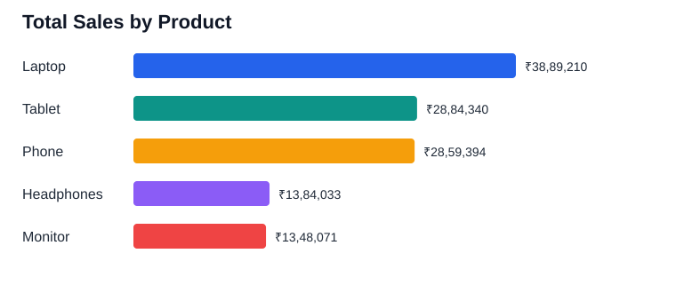
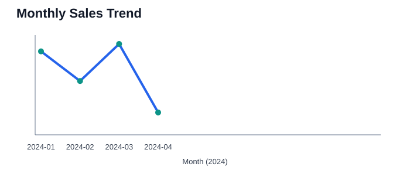
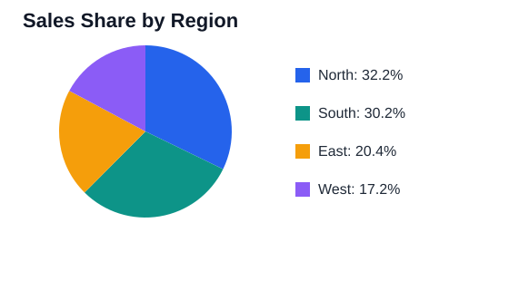

# Week 4: Complete Sales Data Analysis Report

## Project overview
This project analyzes the provided sample e-commerce sales data using Python, pandas, and Matplotlib. It covers data loading, validation, cleaning, metrics, visualizations, and written findings.

## Dataset
- Records supplied: 100
- Columns: Date, Product, Quantity, Price, Customer_ID, Region, Total_Sales
- Date range: 2024-01-01 to 2024-04-09
- Products: Phone, Headphones, Laptop, Tablet, Monitor
- Regions: East, North, West, South

## Key metrics
- **Total revenue:** ₹1,23,65,048.00
- **Average sale value:** ₹1,23,650.48
- **Highest individual sale:** ₹3,73,932.00
- **Lowest individual sale:** ₹6,540.00
- **Total units sold:** 478
- **Unique customers:** 100
- **Top product by revenue:** Laptop (₹38,89,210.00)
- **Highest-revenue month:** 2024-03 (₹44,85,006.00)
- **Highest-revenue region:** North (₹39,83,635.00)

## Visualizations
The SVG charts below are previews committed with the project. Running main.py generates the corresponding PNG charts using Matplotlib.

### Revenue by product

### Monthly revenue trend

### Revenue share by region

## Analysis workflow
1. Read the CSV with pandas.
2. Validate required columns and convert dates/numbers.
3. Remove exact duplicate rows and rows missing essential fields.
4. Recalculate revenue as Quantity multiplied by Price.
5. Summarize sales by product, month, and region.
6. Generate charts with Matplotlib and save a Markdown report.

## Setup and run
On Windows, run `py -m pip install -r requirements.txt` and then `py main.py`. On macOS/Linux, run `python3 -m pip install -r requirements.txt` and then `python3 main.py`.

## Interpretation
The product with the highest total revenue is **Laptop**. The monthly chart lets a reader compare the four months in the dataset, while the regional chart compares each region's share of revenue. These findings apply only to this practice dataset.

## Limitations
This is practice data, not verified real-world business data. Revenue metrics use Quantity × Price.
